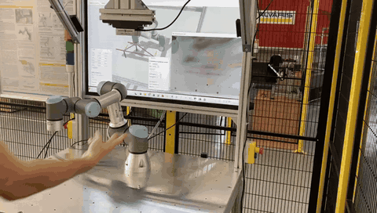

# Gesture-Controlled Robot On/Off Switch



[▶ Watch the full video](Real_time_video.mp4)

Real-time hand gesture recognition that starts and stops the trajectory of a **UR3 collaborative robot**. The user shows a gesture to the camera, a machine learning model classifies it, and the result is sent over **TCP/IP** as JSON to the robot control application.

> Master's thesis *Hand and Gesture Detection System*, VŠB – Technical University of Ostrava, Department of Robotics (2026)
> Supervisor: doc. Ing. Tomáš Kot, Ph.D.

## How it works

```
Gesture → Intel RealSense D435 → MediaPipe Hands (21 landmarks)
        → classifier (Random Forest / Logistic Regression)
        → TCP server ──JSON──► TCP client app → UR3 robot
```

- **Gesture 1** starts the robot trajectory
- **Gesture 4** stops it

## Approach

1. **Dataset:** 5 visually distinct gestures from the [ASL Alphabet](https://www.kaggle.com/datasets/grassknoted/asl-alphabet) dataset (3,000 images per class), extended with 900 of my own images per class taken about 1 m from the camera.
2. **Feature extraction:** MediaPipe detects 21 hand landmarks. Their x and y coordinates form a 42-value feature vector. Images where no hand is found, mostly very dark ones, are skipped.
3. **Training:** two scikit-learn models, Logistic Regression and Random Forest, trained with a stratified 80/20 split, `StratifiedKFold` cross-validation and `GridSearchCV` hyperparameter tuning.
4. **Real-time inference:** each frame is classified, and only predictions above 75 % confidence are sent to the TCP client.

**Why MediaPipe + a custom classifier?** MediaPipe runs in real time on a CPU with low latency. Training your own model on its landmarks lets you add **any new gesture** by dropping in a folder of images and retraining.

## Results

Both models reach **100 % accuracy, precision, recall and F1** on the held-out test set.

My own images taken at a greater distance considerably improved the average prediction confidence at 1 m:

| Training data | Distance | G0 | G1 | G2 | G3 | G4 |
|---|---|---|---|---|---|---|
| Public dataset | 30 cm | 99 % | 95 % | 90 % | 60 % | 95 % |
| Public dataset | 1 m | 65 % | 52 % | 0 % | 0 % | 85 % |
| **Public + own data** | 30 cm | 99 % | 95 % | 93 % | 90 % | 99 % |
| **Public + own data** | 1 m | 98 % | 85 % | 93 % | 93 % | 99 % |

- ✅ Works in normal and reduced lighting, with the hand in a sleeve, and with skin-coloured gloves
- ⚠️ Partial recognition in very poor light
- ❌ Does not recognize gloves whose colour differs strongly from skin (e.g. blue)

## TCP output

The server sends one JSON message per recognized gesture:

```json
{
  "Datum": "2026-04-20 14:32:10",
  "Gesto": "1",
  "Pravdepodobnost": 0.96,
  "Hloubka_m": 0.98,
  "Landmarky_m": [[0.41, 0.62], [0.44, 0.58], "..."]
}
```

The fields are: detection time, gesture class, confidence, hand distance from the camera, and the x, y coordinates of all 21 landmarks.

## Quick start

**Requirements:** Python 3.10, Intel RealSense D435

```bash
pip install opencv-python mediapipe pyrealsense2 scikit-learn numpy
python Real_time_TCP.py
```

Set the model path in `Real_time_TCP.py` to `RF_model_vsb.p` first. The server listens on port `65432`. Press `Q` to quit.

## Repository

| File | Description |
|---|---|
| `Real_time_TCP.py` | Real-time gesture recognition + TCP server |
| `RF_model_vsb.p` | Trained Random Forest model |
| `LR_model_vsb.p` | Trained Logistic Regression model |
| `Real_time_video.mp4` | Demo on the UR3 robot |
| `Real_time_video_preview.gif` | Auto-playing demo preview (silent, 6 fps) |

**Tech stack:** Python · MediaPipe · OpenCV · scikit-learn · Intel RealSense · TCP/IP · UR3
